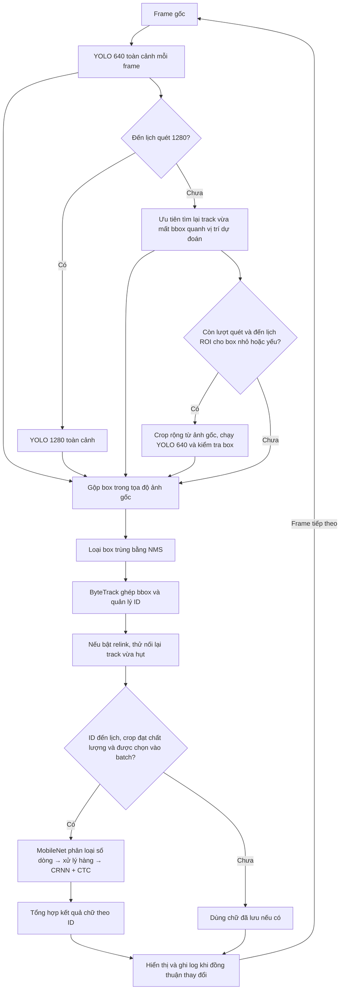

# Nhận diện biển số — YOLOv8n, ByteTrack và OCR

Chạy `scripts/realtime_lp_ocr.py` để phát hiện, theo dõi và đọc biển số. Mặc định chương trình quét bổ sung, nối lại ID vừa mất dấu, mở cửa sổ kết quả và giới hạn tốc độ phát theo FPS nguồn.

## Cách chạy

Chạy trong PowerShell tại thư mục gốc project. Cần cài Git LFS để tải ba checkpoint trong `weights/`. Tạo môi trường ảo một lần, ưu tiên Python 3.11.

```powershell
git lfs install
git lfs pull
python -m venv venv
.\venv\Scripts\Activate.ps1
python -m pip install -r requirements.txt
```

```powershell
# Webcam mặc định, đổi 0 thành 1 nếu dùng camera thứ hai
python scripts/realtime_lp_ocr.py --source 0

# Video cục bộ, thay bằng đường dẫn video của bạn
python scripts/realtime_lp_ocr.py --source "data/test/test2.mp4"
```

Nhấn **Q** hoặc **Esc** để dừng. Dùng `--no-show --no-paced` để chạy benchmark. Dùng `--no-adaptive` để chỉ quét toàn cảnh mỗi frame rồi chạy ByteTrack và OCR. Mặc định tự chọn CPU hoặc GPU. Muốn dùng GPU NVIDIA, môi trường cần PyTorch và torchvision có hỗ trợ CUDA. Mỗi lượt chạy lưu video, log từng frame và thống kê ở `runs/plate_recognition/`. Video trong `data/` do bạn tự cung cấp.

Số ID trên bbox và trong log `CONSENSUS` được cấp lần lượt từ 1 khi mỗi track xuất hiện lần đầu. Số đó được giữ nếu cùng track xuất hiện lại. Trong `frames.jsonl`, `tracks[].display_id` là số hiển thị và `tracks[].id` là ID ByteTrack dùng để đối chiếu `readings.json` và các lần `id_relinks`.

## Pipeline adaptive



Mặc định quét 1280 mỗi **30 frame**. Các frame còn lại có tối đa **2 vùng ROI** mỗi frame. Ưu tiên tìm lại track đã xác nhận trong tối đa **3 frame** kể từ lần cuối có bbox khớp. Vị trí dự đoán chỉ dùng để chọn vùng tìm. Bbox đưa vào ByteTrack phải đến từ ảnh hiện tại. Nếu còn lượt, kiểm tra thêm box nhỏ hoặc yếu theo lịch **mỗi 5 frame**. Box yếu vẫn có thể giúp ByteTrack nối ID đang hoạt động.

Chế độ adaptive mặc định ghép lại ID sau tối đa **3 frame bị hụt**. ByteTrack ưu tiên các cặp đã ghép theo cách cũ, rồi xét tâm và kích thước từ các bbox YOLO gần nhất của track chưa ghép. Chỉ nối khi một bbox mới khớp rõ một-một với track đã xác nhận. `frames.jsonl` ghi `id_relinks` ở frame có lượt ghép này. Dùng `--no-relink` để đối chứng.

YOLO mặc định dùng ảnh xám ba kênh. Thêm `--no-grayscale` để đối chứng với đầu vào màu. OCR và video hiển thị dùng frame màu gốc.

```powershell
python scripts/realtime_lp_ocr.py --source "data/test/test6.mp4"
```

Ở chế độ OCR theo lịch, ID mới phải xuất hiện **5 frame liên tiếp** trước lần đọc đầu. Sau đó, chờ ít nhất **10 frame** giữa hai lần đọc hoặc **30 frame** khi đã đạt `CONSENSUS`. Mỗi frame đọc tối đa **4 crop**. `CONSENSUS` phản ánh sự đồng thuận giữa các lần đọc và vẫn có thể sai.
