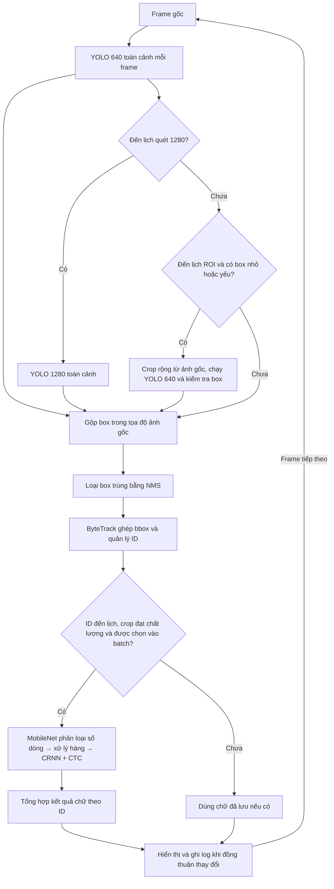

# Nhận diện biển số — YOLOv8n, ByteTrack và OCR

Bản adaptive phát hiện và theo dõi biển số qua video, rồi đọc ký tự theo lịch riêng cho từng ID. Bản chỉ detect và tracking vẫn chạy bằng `scripts/realtime_lp_bytetrack.py`.

## Cách chạy

Chạy trong PowerShell tại thư mục gốc project. Cần cài Git LFS để tải ba checkpoint trong `weights/`. Tạo môi trường ảo một lần, ưu tiên Python 3.11.

```powershell
git lfs install
git lfs pull
python -m venv venv
.\venv\Scripts\Activate.ps1
python -m pip install -r requirements.txt
```

```powershell
# Webcam mặc định, đổi 0 thành 1 nếu dùng camera thứ hai
python scripts/realtime_lp_ocr.py --source 0 --adaptive --show

# Video cục bộ, thay bằng đường dẫn video của bạn
python scripts/realtime_lp_ocr.py --source "data/test/test2.mp4" --adaptive --show --paced
```

Nhấn **Q** hoặc **Esc** để dừng. Bỏ `--show` khi đo tốc độ không cần cửa sổ, bỏ `--adaptive` để chạy YOLO toàn cảnh mỗi frame + ByteTrack + OCR. Mặc định tự chọn CPU hoặc GPU. Muốn dùng GPU NVIDIA, môi trường cần PyTorch và torchvision có hỗ trợ CUDA. Mỗi lượt chạy lưu video, log từng frame và thống kê ở `runs/plate_recognition/`. Video trong `data/` do bạn tự cung cấp.

## Pipeline adaptive



Mặc định quét 1280 mỗi **30 frame**. Ở các frame đến lịch ROI (**mỗi 5 frame**) mà không quét 1280, kiểm tra tối đa **2 vùng**. Box yếu từ lượt toàn cảnh vẫn có thể giúp ByteTrack nối ID đang có. OCR xét ID mới ngay, sau đó chờ ít nhất **10 frame** giữa hai lần đọc hoặc **30 frame** khi đã đạt `CONSENSUS`. Mỗi frame đọc tối đa **4 crop**. `CONSENSUS` phản ánh sự đồng thuận giữa các lần đọc và vẫn có thể sai.

[Demo chỉ detect và tracking](docs/bytetrack_demo.md) · [Benchmark YOLO / CSRT / ByteTrack](docs/benchmark_yolo_csrt_bytetrack.md)
